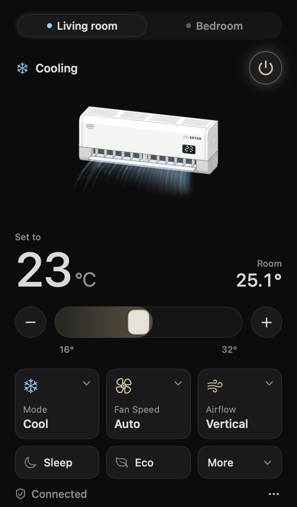
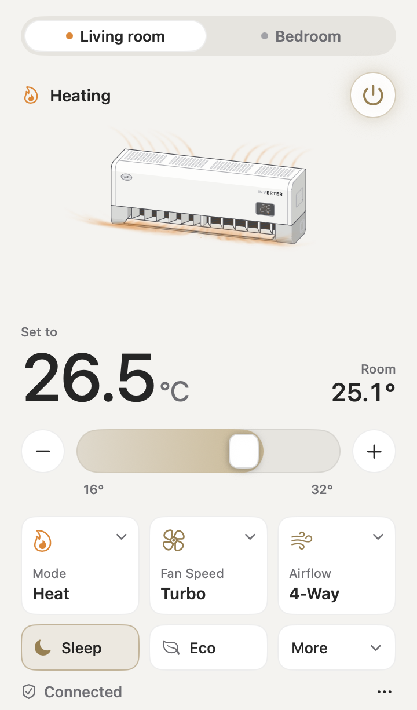
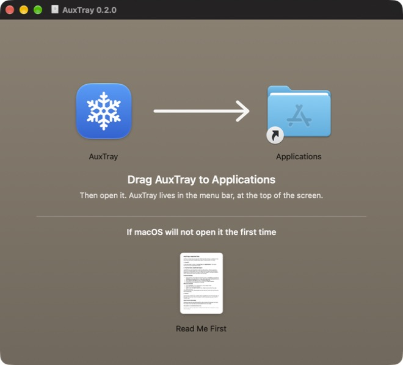
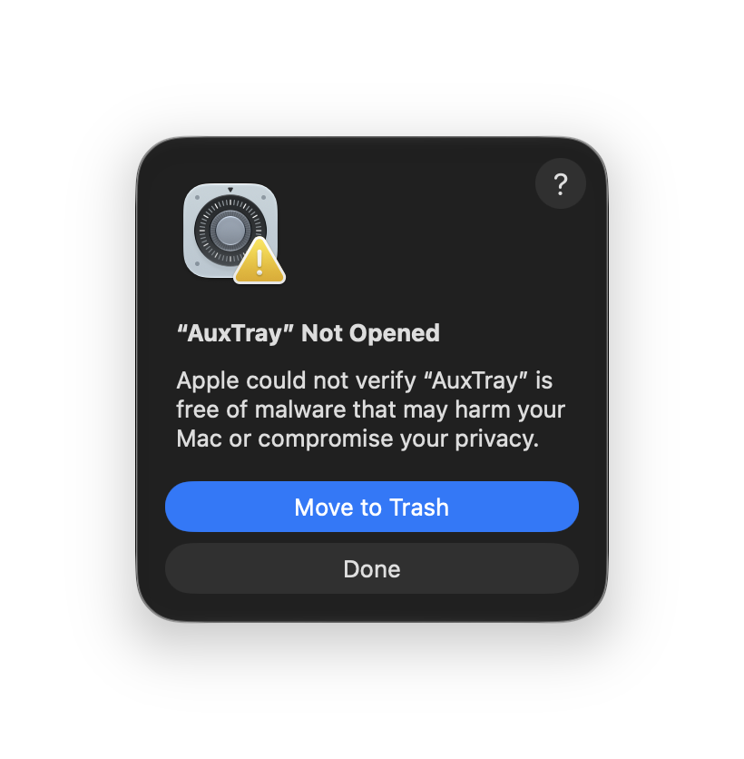

# AuxTray

A menu-bar app for macOS that controls HAAM air conditioners, and other AUX-made units that are set up with the
**AC Freedom** phone app. Click the icon in the menu bar and the unit is there: on or off, the temperature, the
mode, the fan, the louvers.

<p>
  
  
</p>

**[Download the latest version](https://github.com/atefalshehri/AuxTray/releases/latest)**. It is free. It needs
macOS 14 or later and runs on Apple-silicon and Intel Macs.

AuxTray is a hobby project, made by one owner for the units in one home and shared in case it is useful in yours.
It comes with no promises. It is not made by, endorsed by or affiliated with HAAM, AUX or BroadLink. Their names
appear here only to say what it works with.

This page holds the app to download and the place to report a problem. The app's source code is not published.

## What it does

- Shows each air conditioner on your AC Freedom account, with a drawing of the unit that follows what the real one
  is doing.
- Turns it on and off, and sets the temperature (16 to 32 °C, in half degrees), the mode (cool, heat, dry, fan,
  auto), the fan speed and the airflow.
- Switches sleep, eco, the unit's display, health, self-clean, mildew-proof and child lock, on the units that have
  them.
- Puts the room temperature, the set temperature, or both in the menu bar.
- Stays quiet when it is closed. See [What it sends, and when](#what-it-sends-and-when).

## Will it work with my air conditioner?

If you control the unit with the AC Freedom app on your phone, it probably will. AuxTray uses the same service that
app uses.

It has been used every day with one model, the HAAM HM18HO25INV split unit. Other AUX-made models that AC Freedom
handles are recognised by their product code, and each is offered the fan steps, modes and features that model
has. Those have not been tried with AuxTray itself. If yours behaves oddly,
[tell the project](#if-something-is-wrong): that is how it gets fixed.

AUX heat pumps on the same account are listed, but AuxTray does not control them.

## Install

1. Download `AuxTray-0.2.0.dmg` from the [latest release](https://github.com/atefalshehri/AuxTray/releases/latest).
2. Open it, and drag **AuxTray** onto **Applications**.
3. Open AuxTray from your Applications folder.



### The first time, macOS will stop it

macOS shows this warning:



That is expected. AuxTray is not registered with Apple's paid developer programme, so macOS has no way to check
who made it. You have to allow it once. There are two ways, and either one is enough.

**In System Settings**

1. In the warning, click **Done** (on macOS 14, **Cancel**). Do not click Move to Trash, which may be the
   highlighted button.
2. Open **System Settings** and go to **Privacy & Security**.
3. Scroll down to the line about AuxTray and click **Open Anyway**.
4. Confirm with your password or Touch ID.

**With one command**

Open **Terminal** (it is in Applications, in the Utilities folder), paste this line and press Return. Then open
AuxTray.

```bash
xattr -dr com.apple.quarantine /Applications/AuxTray.app
```

That line removes the "downloaded from the internet" mark from AuxTray and from nothing else.

Allowing an app this way tells macOS to skip its check for that app. Do it only for a copy of AuxTray that you
downloaded from this page. The same steps are in **Read Me First**, inside the disk image.

### Find it

AuxTray has no Dock icon. Look for the air-conditioner icon in the menu bar, at the top of the screen.

### Updating

Quit AuxTray (the menu behind the ⋯ button, then **Quit AuxTray**), download the new version, and drag it onto
Applications again, replacing the old one. macOS asks you to allow the new copy the same way.

## Signing in

Use the account from the AC Freedom app: the one your air conditioner is set up on, or one it was shared with.

**Region.** Pick the region you chose when you made the account. Accounts made in Saudi Arabia, the United States
and most other countries are under "Other regions". If signing in is refused and you are sure of the password, try
another region: an account exists in one region only.

**The password.** AuxTray keeps it in the macOS Keychain and uses it to sign in again when AC Freedom ends the
session. Because AuxTray is not signed by a registered developer, macOS asks for permission to read that item again
after every update. Choose Always Allow.

## What it sends, and when

AuxTray talks to one place: the AC Freedom cloud, on the host for your account's region. It sends your account
name and password there to sign in, as the phone app does. It sends nothing anywhere else. There is no analytics
and no telemetry.

| Region | Host |
|---|---|
| Other regions | `app-service-usa-fd7cc04c.smarthomecs.com` |
| Europe | `app-service-deu-f0e9ebbb.smarthomecs.de` |
| Russia | `app-service-rus-b8bbc3be.smarthomecs.com` |
| Mainland China | `app-service-chn-31a93883.ibroadlink.com` |

On your Mac, the password is in the Keychain. The session that AC Freedom hands back, and your settings, are in the
app's preferences.

A status reading is not free: the cloud passes it on to the unit, and the unit answers. So AuxTray reads your
units only while its window is open (every 20 seconds, and every couple of minutes for the units you are not
looking at). Close it and it goes silent.

If you want the menu bar's temperature kept current while the window is closed, turn on **Keep Menu Bar Updated**
in the menu behind the ⋯ button. It then reads the one unit shown in the menu bar, every five minutes. It is off
unless you turn it on.

## Known limits

- Degrees Celsius only.
- English only. Arabic is planned.
- Used with one region ("Other regions") and with e-mail sign-in. The other regions and phone-number sign-in are
  there but untried.
- Used on macOS 27, on an Apple-silicon Mac. It is built to run on macOS 14 and later, and it is built, tested and
  started automatically on macOS 15, on an Apple-silicon and on an Intel Mac. Nobody has yet used it there day to
  day.
- macOS warns about it the first time you open it. See [Install](#the-first-time-macos-will-stop-it).
- It depends on a service its makers have not opened to others. If they change it, AuxTray stops working until it
  is updated.

## If something is wrong

Open the menu behind the ⋯ button and choose **Report a Problem…**. A window opens with a box for you to say what
happened, and under it the report that goes along, shown in full:

- the app's version, your macOS version and the region;
- for each device, its product code and the values it reports;
- the last things AuxTray asked of AC Freedom, and how each went.

The report has no account name, no device names, no ids, no addresses and no keys. Failures are quoted by their code
alone, and times as "how long ago".

**Continue on GitHub** opens [this project's report form](https://github.com/atefalshehri/AuxTray/issues) in your
browser with all of it filled in, for you to read once more and post. Posting needs a free GitHub account, and what
you post is public under that account's name. AuxTray itself sends nothing. If you would rather pass it on some
other way, **Save as a File…** and **Copy** give you the same text, and **Copy Diagnostics** in the menu copies the
report alone.

Common things:

- **"No air conditioners yet."** The account you signed in with has none. Check the region, and that this is the
  account the unit was set up on or shared with.
- **"This unit isn't answering."** AC Freedom cannot reach it. Check that the unit has power and is on Wi-Fi, and
  whether the phone app can reach it.
- **"AuxTray doesn't know this device yet."** It is a product AuxTray has not met, and it does not answer the way
  an air conditioner does. Send the diagnostics and it can be added.

To report a security problem, see [SECURITY.md](SECURITY.md).

## Removing it

If you turned on **Launch at Login**, turn it off first. Then quit AuxTray (the menu behind the ⋯ button, then
**Quit AuxTray**) and drag it from Applications to the Trash.

Your settings and the saved password stay, in case you install it again. To remove those too, paste these two lines
into Terminal, one at a time:

```bash
defaults delete com.atef.AuxTray
```

```bash
security delete-generic-password -s com.atef.AuxTray
```

## Thanks

- The unit is drawn with the isometric kit from [Anatomy](https://github.com/wheresryan22/anatomy) by Ryan (MIT).
- [ha-aux-cloud](https://github.com/maeek/ha-aux-cloud) by maeek (MIT), the Home Assistant integration for the same
  units, was the cross-check for how the service is spoken to, and its table of models is the one AuxTray follows.

Their licence notices are in [NOTICES.md](NOTICES.md), and a copy travels inside the app.

## Licence

AuxTray is free to use and to share under the [MIT licence](LICENSE). HAAM, AUX, AC Freedom and BroadLink are names
and trademarks of their owners.
